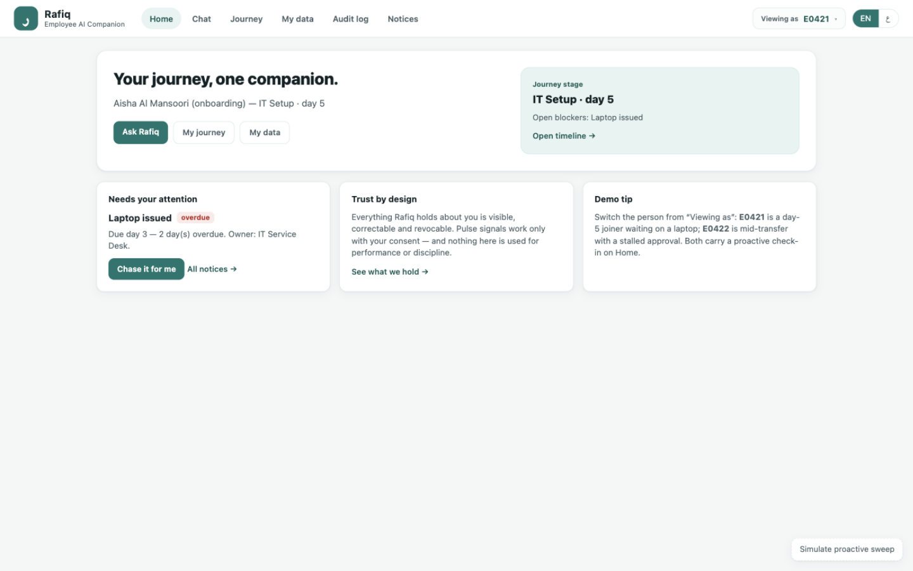
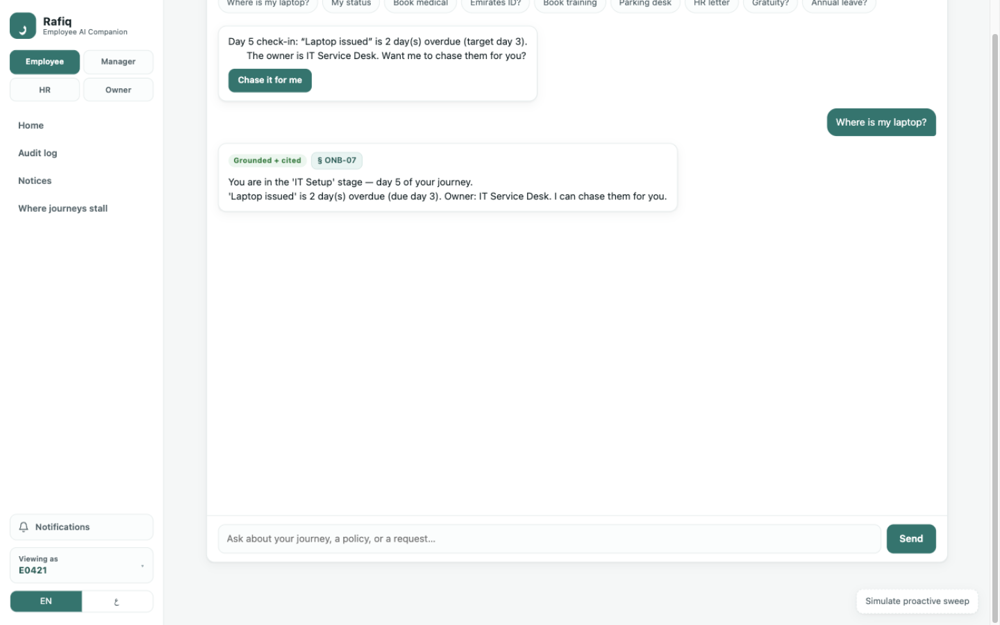
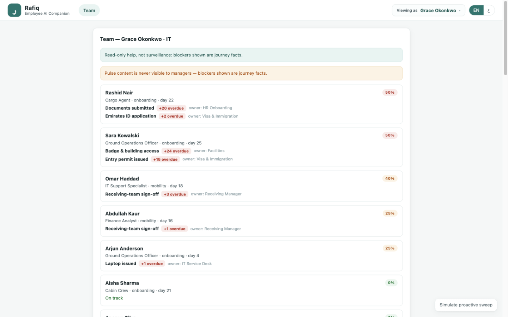
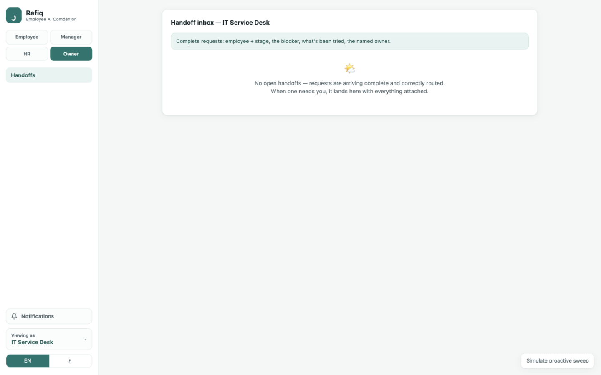

# Rafiq — Employee AI Companion

<p align="center">
  
</p>

An employee-owned AI companion that carries a person across **both** the onboarding and the
internal-mobility journey, answers policy questions with inline citations, and quietly catches
friction *before* it becomes a complaint — on a consent-first, UAE-sovereign footing.

Unlike support bots that only answer and marketplaces that only match, Rafiq knows where you are
in your journey, cites the policy behind every answer, and flags a stall to the right named owner
before you have to chase it yourself.

> Built for the Ignyte × Emirates "Employee AI Companion" challenge. All data is synthetic.
>
> **Muhammad Omaid — Magnus Mage (dev team)**

## Quick start

```bash
uv sync                                   # or: pip install -e ".[dev]"
uv run uvicorn app.main:app --port 8000   # or simply: make run
uv run pytest -q                          # 39 tests: engine, RAG grounding, consent, sweep
```

No API keys are required — without one, answers are composed **extractively from retrieved
policy text** (still cited, zero hallucination surface). To add generative polish, copy
`.env.example` → `.env` and set `OPENROUTER_API_KEY` or `GROQ_API_KEY`.

## The two-minute tour

With the app open, in order — every step is one click from the side rail:

1. **Home** opens on E0421 (Aisha, onboarding day 5): her laptop blocker is already flagged.
2. **Ask Rafiq** → tap *Where is my laptop?* → deterministic answer citing **ONB-07** →
   *Chase it for me* → a handoff card is raised (see it land in the owner's inbox in step 5).
3. **My journey** — the SLA timeline with owners and real-process hints (the medical can be
   done at the visa window; Emirates ID biometrics at the same visit).
4. **My data** → toggle *pulse consent* live; the audit log records it, and with consent OFF
   the pulse signal is excluded everywhere (asserted by a test).
5. Role buttons: **Manager** (Grace Okonkwo's risk-sorted team of 34), **HR** (Fatima's
   early-warning queue, 22/109 blocked, plus the handoff inbox with acknowledge/resolve),
   **Owner** (the IT Service Desk inbox).
6. **Where journeys stall** — the aggregate view; **ع** — the full RTL flip; **Viewing as →
   E0422** — the stalled-transfer scenario citing **MOB-01**.

## The problem today — and what this prototype covers

At Emirates scale (131,000+ employees, ~9,700 joiners in the UAE last year), one employee's
experience spans many teams, systems, approvals and policies. Today the warning signals exist —
a journey event that never happened, a request sitting past its SLA, a dip in an opt-in pulse —
but they are scattered across systems and surface only **after** a complaint or escalation.
Employees often don't know where to go; HR finds out late; service owners receive incomplete
requests.

**Scope (per the brief): two journeys only — onboarding and internal mobility.** Out of scope: the
full employee lifecycle, connection to live Emirates systems, and any use in performance or
disciplinary decisions. Everything below stays inside that line.

Common-ground use cases the prototype demonstrates end-to-end:

- *"It is day 5 and I still have no laptop"* — the companion knows the stage, cites the
  provisioning policy (ONB-07), and chases the named owner on request.
- A stalled visa or transfer approval — flagged proactively before the employee complains;
  a complete handoff card reaches the named owner with what's already been tried.
- Policy and process questions (leave, allowances, gratuity, staff travel, WPS) — answered
  **only** from the policy corpus, with a visible citation.
- Routine requests (IT access, medical booking, training, facilities, HR letters) — started and
  routed complete, in one place.
- An HRBP who wants early warning, and a manager who wants to help their new joiners without
  surveilling anyone.

## The demo in 90 seconds

Two scenario employees are seeded (`SIM_DAY=5`):

1. **Day-5 laptop (E0421 · Aisha, onboarding).** Rafiq opens with the blocker proactively:
   laptop due day 3, 2 days overdue, owner IT Service Desk. Ask *"Where is my laptop?"* →
   deterministic journey answer citing **ONB-07** → tap **Chase** → a structured handoff card
   (blocker, what's been tried, named owner) is raised and logged.
2. **Stalled transfer (E0422 · Omar, mobility).** Switch employee → his receiving-team sign-off
   is 3 days past its day-15 SLA. Ask *"What's the status of my transfer?"* → cites **MOB-01**,
   names the Receiving Manager.

Then show the trust surfaces — made clickable, not slideware:

- **My data** — what we hold, your named line manager and HRBP, and the line *"not used for
  performance or discipline — ever"*.
- **Pulse consent toggle** — off ⇒ pulse data is excluded from every signal (tested).
- **Audit log** — everything Rafiq did, timestamped, employee-visible.
- **Simulate sweep** — the proactive engine re-scans all 200 employees, notifies the employee
  first, and escalates persistent stalls to named owners (idempotent per employee/event/day).
- **EN / ع** — full RTL flip (layout mirrors, Arabic answers, Arabic timeline labels).

Then switch **Viewing as** to the other side of the org — the flows run on the same synthetic data:

- **Line manager · Grace Okonkwo (IT)** — a risk-sorted team of 34 with each report's blockers
  and named owners. Read-only help, not surveillance: pulse content is never visible to managers.
- **HRBP · Fatima Al Hashimi** — an early-warning queue (only real stalls, each already seen by
  the employee first) aggregated by owner, plus the **Handoff inbox**: complete cards (stage,
  blocker, what's been tried, named owner) that the owner can acknowledge and resolve — which the
  employee sees in their own audit log.

**Brief coverage** (What to Build → where it lives):

| Brief requirement | Where it is |
| --- | --- |
| Knows the journey stage and what's next (day 5, laptop not issued) | Journey engine + timeline + proactive check-ins |
| Answers policy questions, citing the source policy | Grounded RAG answer cards with `policy_id · section` chips |
| Completes/starts routine requests, handing to HR, IT, learning workflows | Request routing to Payroll, IT Service Desk, Learning & Development, Facilities, HR — with handoff cards |
| Spots friction early (events, request delays, opt-in pulse) | Friction radar + idempotent sweep |
| Escalates to the right human owner with a summary | Handoff inbox with named owner, acknowledge/resolve |
| Nice to have: Arabic + English | Full RTL flip, Arabic corpus, Arabic answers/timeline |
| Nice to have: manager view for new joiners | Team view, risk-sorted, pulse never visible |
| Nice to have: where journeys stall most often | **Stall map** — aggregate bars by stage + owner chips, never an individual |

Employee-side quality-of-life: a **notification bell** in the side rail (unread count + tray),
**search** in the View-as switcher, **filters** on the team/queue lists, and seeded history so
the audit log and notices are never empty on a fresh open.

## See it in action

Four screens carry the demo.

| Screen | What it shows | What was achieved |
| --- | --- | --- |
|  | **Home — the proactive cold-open.** Aisha, day 5 of onboarding: her stage, her open blocker and a one-tap chase are on screen *before she asks*. The optional pulse check-in sits beside the trust statement, dismissible, with an honest note that unanswered consent means the answer is acknowledged but not used. | Friction surfaced before the complaint; trust expressed in the interface itself — the blocker is the employee's own, the pulse is opt-in and honest about its limits. |
|  | **Chat — grounded and cited.** "Where is my laptop?" gets a deterministic journey answer citing policy **ONB-07** with the named owner (IT Service Desk); *Chase* raises a structured handoff card that lands in the owner's inbox. | Reliability under unfamiliar questions: the answer is computed from events vs targets, not generated; the citation is real corpus text; the handoff is complete and correctly routed. |
|  | **Manager view — read-only team help.** Grace Okonkwo (IT) sees her 34 reports risk-sorted with journey facts only. Two notes say it outright: help, not surveillance — pulse content is never visible to managers. | The companion works in *both* directions without becoming a monitoring tool: the manager endpoint structurally cannot read pulse data, and the privacy line is enforced in code, shown on screen. |
|  | **Handoff inbox — the service owner's side.** The IT Service Desk owner receives complete cards: employee and stage, the blocker, what's already been tried, a summary, and acknowledge/resolve actions — each status change landing back in the employee's audit log. | Requests arrive complete and correctly routed, as the brief asks of service owners; the loop closes with the employee able to see every step taken on their behalf. |

## Architecture

Two views of how Rafiq works.

<p align="center">
  
</p>

**Overview — a proactive, agentic companion: grounded, gated, human-owned.** The left flow is
the answer path (orchestrator → journey-state / policy / action agents); the friction radar
watches events, SLAs and consented pulse dips and pushes in *before* the employee asks. Every
answer and action passes the trust gate; grounding comes from the journey-state store, the cited
policy store and (in a pilot) read-only HRIS/ITSM connectors; escalations always land with a
named human owner.

<p align="center">
  
</p>

**Zoned view — where data lives and where it may go.** Zone 1 is the employee and their
channels; zone 2 is the companion, with the trust gate drawn as a band because *every* answer and
action crosses it; zone 3 is data + people: journey and consent stores, the cited policy corpus,
an append-only audit log, and the Emirates systems reached through connectors that are synthetic
in the build and read-only in a pilot. The subtitle is the operating posture — employee-owned,
grounded and gated, in-region (PDPL), human-owned escalations — enforced in code.

## Code map — the four parts and the trust layer

| Part | What it does | Where |
| --- | --- | --- |
| Journey-state engine | Deterministic: joins journey events against `journey_maps.md` target days → stage, blockers, timeline. A rule anyone can verify by hand. | `app/core/journey_engine.py` |
| Grounded answer layer | BM25 retrieval with Arabic-aware normalization + heading anchors over a bilingual policy corpus; every answer cited (`policy_id · section`); below threshold ⇒ "I'm not sure" + handoff. | `app/core/rag.py`, `app/agents/policy_agent.py` |
| Action & routing | Rules-first orchestrator (sensitive → human, status → journey, verbs → action, else policy); chases and request creation produce structured handoff cards. | `app/agents/orchestrator.py`, `action_agent.py` |
| Friction radar | Explainable weights: +0.25/overdue event, +0.15/past-SLA request, +0.10 consented pulse dip. Employee sees it first; only persistent stalls escalate. | `app/core/friction.py`, `app/services/scheduler.py` |
| Trust layer | Consent store, employee-visible audit log, PII redaction, sensitive-topic guard, one `trust_gate` wrapping every answer. | `app/core/consent.py`, `guardrails.py` |

LLM calls live in exactly one file (`app/core/llm.py`) — swap in Falcon-H1 Arabic / JAIS
on-premise for the sovereign production path without touching anything else.

## Data

`app/services/data.py` loads from **`data/pack/`** (the official challenge pack) and falls back to
`data/synthetic/`, which mirrors the documented schema — `journey_events.csv`,
`service_requests.csv`, `pulse_feedback.csv`, `employees.csv`, `journey_maps.md` and
`policies/{en,ar}/*.md` (17 bilingual policies). Column aliases make the loader tolerant of a
differently-named official pack. Regenerate the synthetic pack:

```bash
uv run python scripts/make_synthetic_data.py --employees 200 --sim-day 5
```

To plug in the official pack: create `data/pack/`, drop the files in, restart. Nothing else
changes — the same engine, thresholds and surfaces run on it.

## What was accomplished — in detail

**Task accomplished: hidden scenarios resolved or routed correctly, with accurate policy answers.**

- Journey state comes from a deterministic rule engine, not a model
  (`app/core/journey_engine.py`): completed events are joined against the `journey_maps.md`
  targets; `day > target` with no completion ⇒ blocker with the map's named owner. There is no
  scenario-specific code — a stalled-visa case falls out of the same rule as the day-5 laptop.
- Policy answers are composed only from retrieved corpus text (`app/core/rag.py`): BM25 with
  Arabic-aware normalization (diacritics stripped, alef/ya/ta-marbuta unified) plus heading-anchor
  ranking over 17 bilingual policies. Below the retrieval floor the reply is *"I'm not sure"* plus
  a handoff — enforced by one `trust_gate` wrapper (`app/core/guardrails.py`), not by prompting
  discipline. With an LLM key, generation is temperature-0 and context-bound; without one, answers
  are extractive from the retrieved policy — same citations, zero hallucination surface.
- Sensitive topics (visa problems, medical circumstances, grievance) route to a named human
  before any answer is attempted (`is_sensitive()` direct + combination guard).
- Data gaps degrade safely: unknown employee, missing target, failed retrieval all end in
  *"I can't verify — here's who to ask"*, never a guess. Covered by tests:
  `test_low_confidence_becomes_handoff`, `test_gibberish_stays_below_threshold`,
  `test_sensitive_routes_to_human`, `test_employee_not_found_gives_day_zero`.

**Task accomplished: an employee can live in this app — easy, helpful, trustworthy in a live demo.**

- No cold start: Home opens on the employee's live stage and blocker; Chat always opens with
  content (check-in or a capability guide); nine quick chips cover every request type in the brief.
- A notification bell with an unread tray; the journey timeline mirrors the real process —
  early-completion hints ("medical at the visa window", "Emirates ID biometrics at the same visit")
  instead of a rigid checklist — with one-tap chase on overdue steps.
- Fully bilingual: Arabic corpus, Arabic answers and timeline labels, and a true RTL flip that
  mirrors the whole layout (logical CSS properties, `dir=auto` content).

**Task accomplished: opt-in consent, the employee sees their own data, human handoffs, no use in performance decisions.**

- Consent is enforced at the signal level, not the UI: `app/core/friction.py` adds the pulse term
  only when `ConsentStore.is_opted_in()` is true; revocation excludes the signal immediately
  (`test_consent_gates_pulse_signal`), and answering a pulse without consent is acknowledged but
  explicitly not used.
- The employee sees exactly what is held (`/me/data` — profile, manager, HRBP, journey, requests,
  pulse count) and everything the companion did on their behalf (`/me/audit`, append-only).
- The manager view contains no pulse fields *by construction* — the endpoint never reads them
  (`test_team_view_groups_reports` asserts absence); the HRBP queue and stall map are aggregate
  only, never individual.
- PII is redacted on every reply (`redact_pii`); every escalation carries a named human owner;
  owners acknowledge and resolve in their inbox, and those status changes appear in the
  employee's own audit log.

**Task accomplished: fits Emirates' environment and deploys for other government entities.**

- Everything is self-hosted and offline-capable: FastAPI + pandas + a dependency-free BM25 index.
  No pack data ever leaves the box — directly compliant with *"do not upload the pack to services
  that keep or train on it."*
- The sovereign path is one file: `app/core/llm.py` is the only place a model is called, so
  Falcon-H1 Arabic or JAIS on-premise drops in without touching agents or API.
- The loader (`app/services/data.py`) maps columns through aliases and prefers `data/pack/` when
  the official pack is dropped in — same engine, same thresholds, zero code change. The
  policy-agnostic corpus layout is packaged for reuse by other government entities.

**Task accomplished: ready to run a pilot next quarter.**

- 39 pytest tests green across the engine, friction weights, RAG grounding, routing, the sweep,
  consent/audit trust surfaces and the org views — the guardrails are asserted, not promised.
- Every tunable (confidence floor, escalate-after, sweep interval) is configuration in `.env`;
  the pilot swap is data + connectors while the deterministic core stays as is.

## Known limitations & what we'd build next

- The prototype reads the pack read-only: request status changes live in runtime stores, not in
  the pack files; a pilot writes back through connectors (the zoned diagram's synthetic adapters).
- Retrieval is BM25 over 17 policies — deliberately dependency-free for the demo. A pilot adds
  hybrid search + a cross-encoder reranker before the corpus grows past ~50 documents.
- Intent routing is rules-first; a small fine-tuned router is the next step once real phrasings
  exist (rules keep the demo deterministic and auditable today).
- Voice is designed for (same agent stack, transcript confirm-before-act) but not built — the
  brief lists it as an optional channel, and text keeps every answer cited and auditable.
- The Arabic corpus is concise by design; a pilot review by UAE HR counsel comes before any
  employee-facing deployment.

## Production notes (described, not needed for the demo)

Hybrid retrieval + cross-encoder rerankers, NeMo/Presidio guardrail stack, Docker compose with
Qdrant/Redis/Ollama, ISO 42001 / NIST AI RMF governance mapping, and the UAE PDPL data-residency
posture are covered in `docs/Employee AI Engineering Workbook.md`, which this build follows.
